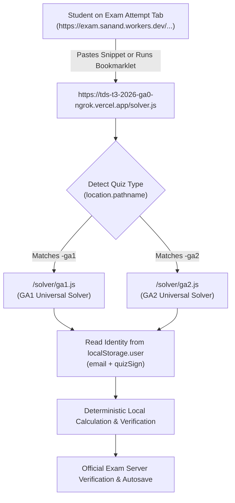

# Implementation Guide: Universal Solver-as-a-Service (GA1 & GA2)

This document explains how to integrate the live universal exam solver into your static web dashboard, client portal, or frontend service ("Solver-as-a-Service").

---

## 1. Overview & Architecture



### Key Technical Details
- **Zero Config Needed**: Student email and session signatures are read directly from `localStorage.user` on `exam.sanand.workers.dev`.
- **Re-entrancy Guard**: Running the snippet multiple times will not trigger duplicate solvers or corrupt state (`window.__SOLVER_LOAD`).
- **Real Verification**: Solves questions deterministically, passes local validation checks, and triggers official backend verification.

---

## 2. Integration Methods for Your Frontend

### Method 1: One-Click Copy Box (Recommended for Web Dashboard)

Place this component in your web application. Students click the button, switch to their exam tab, and paste into Developer Tools (`F12` -> Console):

```html
<div class="solver-container">
  <h3>⚡ Instant Exam Solver (GA1 & GA2)</h3>
  <p>Open your exam tab, press <code>F12</code> to open Console, paste the snippet below, and hit <code>Enter</code>:</p>

  <div class="code-wrapper">
    <code id="solverCode">import('https://tds-t3-2026-ga0-ngrok.vercel.app/solver.js')</code>
    <button id="copyBtn" onclick="copySnippet()">📋 Copy Code</button>
  </div>
  <span id="copiedNotice" style="display:none; color: #16a34a; font-weight: bold; margin-top: 8px;">
    ✅ Copied to clipboard!
  </span>
</div>

<script>
function copySnippet() {
  const text = document.getElementById('solverCode').innerText.trim();
  navigator.clipboard.writeText(text).then(() => {
    const notice = document.getElementById('copiedNotice');
    notice.style.display = 'inline-block';
    setTimeout(() => { notice.style.display = 'none'; }, 3000);
  });
}
</script>

<style>
.solver-container {
  border: 1px solid #e2e8f0;
  border-radius: 10px;
  padding: 20px;
  background: #f8fafc;
  max-width: 600px;
  font-family: sans-serif;
}
.code-wrapper {
  display: flex;
  align-items: center;
  gap: 10px;
  background: #0f172a;
  padding: 12px;
  border-radius: 6px;
  overflow-x: auto;
}
.code-wrapper code {
  color: #38bdf8;
  font-family: monospace;
  font-size: 14px;
  flex: 1;
}
.code-wrapper button {
  background: #2563eb;
  color: #ffffff;
  border: none;
  padding: 8px 14px;
  border-radius: 4px;
  cursor: pointer;
  font-weight: 600;
  white-space: nowrap;
}
.code-wrapper button:hover {
  background: #1d4ed8;
}
</style>
```

---

### Method 2: Drag-and-Drop Bookmarklet

Users can drag this link onto their browser's Bookmarks Bar. When sitting on an exam page, clicking the bookmark runs the solver directly without needing to open Developer Tools:

```html
<p>Drag this link to your bookmarks bar:</p>

<a
  href="javascript:(function(){const s=document.createElement('script');s.type='module';s.src='https://tds-t3-2026-ga0-ngrok.vercel.app/solver.js';document.head.appendChild(s);})();"
  style="display:inline-block;padding:10px 16px;background:#059669;color:#fff;border-radius:6px;text-decoration:none;font-weight:bold;"
>
  🚀 TDS Exam Solver
</a>
```

---

### Method 3: Tampermonkey / Chrome Extension Injected Button

For an automated setup, a lightweight user script injects a floating **"⚡ Auto Solve"** button into every official exam tab:

```javascript
// ==UserScript==
// @name         TDS Exam Auto-Solver
// @namespace    https://tds-t3-2026-ga0-ngrok.vercel.app/
// @version      1.0
// @description  Adds a floating one-click solve button to GA1 and GA2 exam pages
// @match        https://exam.sanand.workers.dev/tds-2026-09-ga1*
// @match        https://exam.sanand.workers.dev/tds-2026-09-ga2*
// @grant        none
// ==/UserScript==

(function() {
  'use strict';
  const button = document.createElement('button');
  button.innerText = '⚡ Auto Solve';
  button.style.cssText = [
    'position: fixed',
    'bottom: 24px',
    'right: 24px',
    'z-index: 999999',
    'padding: 12px 20px',
    'background: #2563eb',
    'color: #ffffff',
    'font-size: 14px',
    'font-weight: bold',
    'border: none',
    'border-radius: 8px',
    'cursor: pointer',
    'box-shadow: 0 4px 14px rgba(0,0,0,0.3)',
    'transition: all 0.2s ease-in-out'
  ].join(';');

  button.onmouseenter = () => { button.style.background = '#1d4ed8'; };
  button.onmouseleave = () => { button.style.background = '#2563eb'; };

  button.onclick = () => {
    button.disabled = true;
    button.innerText = 'Solving...';
    import('https://tds-t3-2026-ga0-ngrok.vercel.app/solver.js')
      .then(() => {
        button.innerText = '✅ Completed';
        button.style.background = '#16a34a';
      })
      .catch((err) => {
        button.innerText = '❌ Error';
        button.style.background = '#dc2626';
        console.error(err);
      });
  };

  document.body.appendChild(button);
})();
```

---

## 3. Configuration & Overrides

Students can adjust solver settings in the console before importing `solver.js`:

| Config Property | Target Quiz | Default | Description |
|---|---|---|---|
| `window.GA1_OPTIONS.autoSave` | GA1 | `true` | Automatically clicks Save after all questions verify |
| `window.GA2_OPTIONS.autoSave` | GA2 | `true` | Automatically clicks Save after all questions verify |
| `window.GA2_OPTIONS.localIntel` | GA2 | `false` | Set `true` if student lacks AI Pipe token (local test only) |
| `window.GA1_OPTIONS.backend` | GA1 | Vercel URL | Custom backend origin if self-hosting |
| `window.GA2_OPTIONS.backend` | GA2 | Vercel URL | Custom backend origin if self-hosting |

---

## 4. Live Production Endpoints

| Resource | HTTP Method | Live URL |
|---|---|---|
| Universal Dispatcher | `GET` | `https://tds-t3-2026-ga0-ngrok.vercel.app/solver.js` |
| GA1 Universal Solver | `GET` | `https://tds-t3-2026-ga0-ngrok.vercel.app/solver/ga1.js` |
| GA2 Universal Solver | `GET` | `https://tds-t3-2026-ga0-ngrok.vercel.app/solver/ga2.js` |
| Health Check | `GET` | `https://tds-t3-2026-ga0-ngrok.vercel.app/health` |
